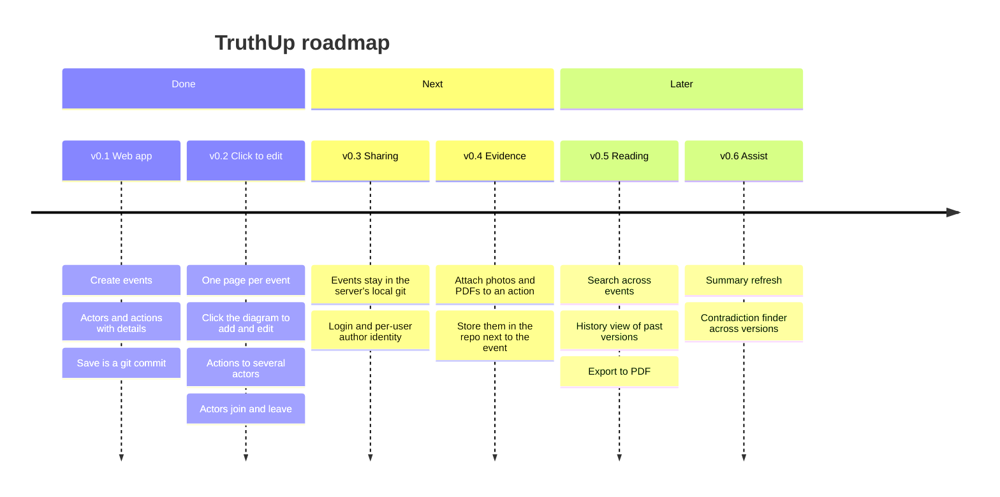

# TruthUp — Plan

## Goal

Long events involve several people and stretch over weeks or months, and the details get
forgotten. TruthUp keeps each event as **one Markdown file whose heart is a Mermaid
sequence diagram, the Timeline**: who did or said what to whom, on which date. The
details for each action sit below the diagram. The file lives in **git**, and every save from the web UI is
a commit, so the event's history and the history of *how we recorded it* are both kept.

## Decisions so far

| Topic | Decision |
|-------|----------|
| Where it runs | Node web server, no dependencies, running the real `git` CLI on a data repo |
| Where events live | Only in that local git repo on the web server. Never pushed to GitHub |
| Diagram rendering | Official Mermaid, installed with npm and served locally (no CDN) |
| What goes in the diagram | Only actions (arrows), grouped by date. No follow-up, decision or review markers |
| Actions | From one actor to one or more actors: one arrow per recipient, same ID |
| Actors over time | An actor can join at its first action (`create`) and leave after its last (`destroy`) |
| Page | One page per event, edited by clicking: Summary, then Timeline and Details tabs. No status |
| Action IDs | Permanent but hidden: `%% E5` in the diagram, `<!-- E5 -->` in Details. Never shown |
| Source of truth | The Markdown file. The page parses it, edits it, and writes it back |
| Save | One button, one git commit. Author = name typed on the page. Message written automatically |
| Conflicts | Save sends the commit it was based on. If the file changed since, the server refuses (409) |

## Roadmap

### v0.1 — Web app (done)

- [x] Event file format, with parser and writer that round-trip byte for byte
- [x] Server: list, create, read, save (commit), delete, history, view an old version
- [x] Tests: format round-trips and the full API flow against a temporary git repo

### v0.2 — Click to edit (done)

- [x] `## Sequence` renamed to `## Timeline` (old files still load). `status` removed
- [x] One page per event: Summary, Timeline, Details, and a single Save button
- [x] Click an actor to edit it. Click two lifelines to add an action. Click an arrow
      or a details entry to edit an action
- [x] An action can go to several actors
- [x] Actors can join later and leave after their last action
- [x] Example updated: the plumber joins at E3 and leaves at E13, the insurer joins at E9
- [x] Summary on top, then Timeline and Details as two tabs
- [x] Action IDs hidden everywhere (Mermaid / HTML comments in the file), also kept out of
      commit messages

### v0.3 — Sharing (next)

- Events are managed by the local git repo on the web server and never pushed to GitHub.
  Backups are a copy of that repo made on the server side (e.g. the server's own disk backups)
- Sign-in so the commit author is the real user, not a typed name
- Safe to run on a shared server: authentication, then binding to more than localhost

### v0.4 — Evidence

- Attach files to an action. Stored in `events/<id>/` and linked from the details

### Open questions

1. Who will use it first: just you, family, or a team? This decides how urgent v0.3 is.
2. Should deleted action IDs stay reserved? Today, deleting the newest action lets its ID
   be reused. Older versions in git still show the original.
3. Should an actor be able to leave and come back later? Mermaid can't re-create an actor
   after `destroy`, so this would need a second actor, such as "Plumber (return visit)".
