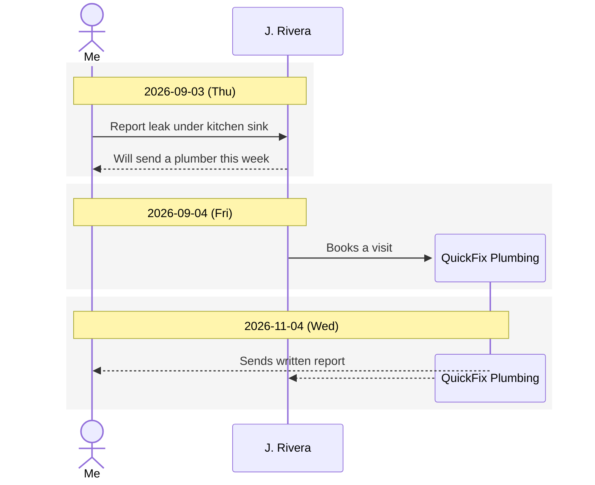

# TruthUp

Record long-running events, with everyone involved, as a **Mermaid sequence diagram in a
Markdown file kept in git**. Each event is one page you edit by clicking on it, and every
**Save is a git commit**, so the history of how the event was recorded is never lost.

## Run it

Needs Node 22+ and git.

```bash
npm install
```

```bash
npm start
```

Open <http://localhost:5180>. On first start the server creates `./data/` as a git
repository and adds one example event. Set `TRUTHUP_DATA=/path/to/repo` to keep events
somewhere else on the server.

Events are managed by this **local git repository on the web server**: every Save is a
commit there, and events never leave that machine. They are not pushed to GitHub:
`data/` is ignored by this repo, and the data repo has no remote.

## Using it

Each event is a single page: the **Summary** on top, then two tabs, **Timeline** (the
diagram) and **Details** (every action with its full notes, grouped by date). Everything
is edited by clicking on it, and the **Save** button commits the whole event.

- **Summary**: click the text to edit it.
- **Scrolling a long timeline**: actor names stay pinned at the top, each above its own
  line, showing only the actors present at that point.
- **On a phone**: the event list and an event are separate screens ("‹ Events" goes
  back). The timeline uses a compact layout with wrapped labels, and a wide diagram
  scrolls sideways. Everything is edited by tapping.
- **Actors**: click **+ Actor**, or click an actor's name in the diagram to edit it.
  An actor can **join later**, appearing at its first action, and **leave after its last
  action**, where its line stops.
- **Actions**: click one actor's lifeline and then another's to add an action between
  them, or use **+ Action**. Click any arrow, or any entry under Details, to edit it.
  An action goes from one actor **to one or more actors**, drawn as one arrow per
  recipient.
- **Save** (or Ctrl/Cmd+S): one git commit. Your name (top right) is the author, and the
  message is written for you, for example `…: add "Asks for an update on the claim"`.
  If someone else saved in the meantime, you're asked to reload instead of overwriting.

## The file format

One event = `data/events/<yyyy-mm>-<slug>.md`. See
[examples/2026-09-kitchen-leak.md](examples/2026-09-kitchen-leak.md).

````markdown
---
id: 2026-09-kitchen-leak
title: Kitchen sink leak, repair and insurance claim
created: 2026-09-03
---

# Kitchen sink leak, repair and insurance claim

## Summary
Where things stand now.

## Actors
| ID | Name | Role / contact |
|----|------|----------------|
| Me | Me | Tenant, unit 2B |
| Landlord | J. Rivera | Owner |
| Plumber | QuickFix Plumbing | Sam |

## Timeline


## Details
### 2026-09-03 · Me → J. Rivera · Report leak under kitchen sink
<!-- E1 -->

Texted 3 photos at 09:12.
````

- Each action has a permanent ID (E1, E2…) that links its arrows to its details entry,
  but the ID is **never shown**: it's a Mermaid comment (`%% E1`) in the diagram and an
  HTML comment (`<!-- E1 -->`) under the details heading. An action you add later for an
  earlier date simply gets the next number and is placed by its date.
- An action with several recipients is one arrow per recipient. Only the first arrow
  shows the text. The others are unlabelled (`Plumber-->>Landlord:`).
- Actions are grouped into one shaded block per date, in date order.
- `->>` is a message or action, `-->>` is a reply.
- An actor that **joins later** is declared with `create participant` right before the
  first arrow that reaches it. Mermaid only allows this on an arrow pointing *to* the
  actor, so its first action must be one it receives. An actor that **leaves** gets
  `destroy` before its last arrow.
- `;` and `#` in text are written as Mermaid entities (`#59;`, `#35;`) so the diagram
  never breaks. The page shows them as normal characters.
- Lines you add to the diagram by hand (notes, `alt` blocks…) and extra `## Sections`
  are kept.
- Older files still open and are converted on the next save: v0.1 (`## Sequence`,
  `status:`) and v0.2 (visible `[E1]` tags on arrows and `### E1 · …` headings).

## Project layout

| Path | What |
|------|------|
| `server.mjs` | Node HTTP server (no dependencies): static files, events API, git commits |
| `web/format.js` | Read and write the event Markdown. Shared by the browser and the server |
| `web/app.js`, `web/index.html`, `web/style.css` | The web page (plain JS, no framework) |
| `examples/` | Seed event copied into a new data repo |
| `tests/` | `npm test`: format tests and API tests against a temporary git repo |

Mermaid is the only dependency. It is installed by npm and served by the server from
`/vendor/mermaid.min.js`, so the browser never loads anything from a CDN.

The server listens on `127.0.0.1` only and has no login. Don't expose it to a network
without adding authentication first. The server also still offers history and
old-version endpoints (`/api/events/<id>/history`, `/versions/<hash>`), which the page no
longer shows. `git log` in the data folder shows the same history.
