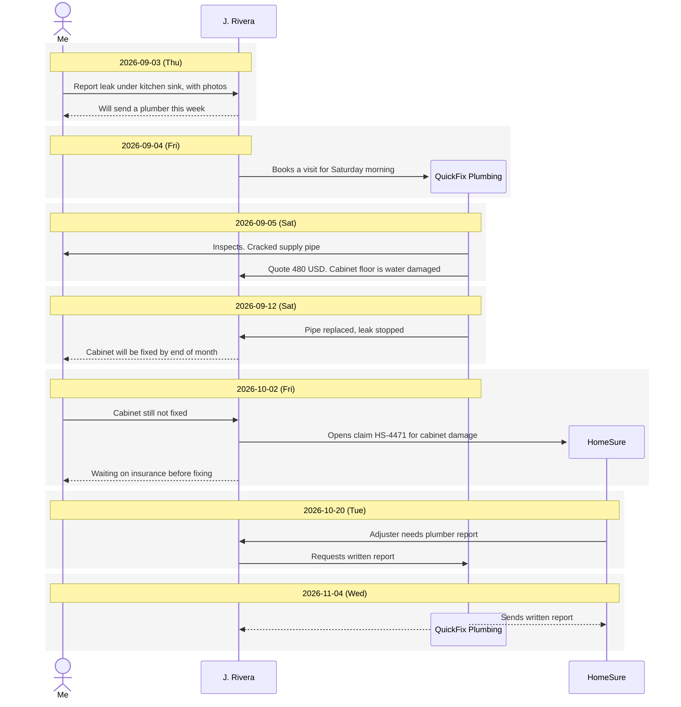

# Kitchen sink leak, repair and insurance claim

## Summary

A leak under the kitchen sink was reported on 2026-09-03. The pipe was replaced on 2026-09-12, but the water-damaged cabinet floor is still not fixed. The landlord opened an insurance claim, and the plumber sent a written report to the insurer on 2026-11-04. Waiting on the insurer's decision.

## Actors

| ID | Name | Role / contact |
|----|------|----------------|
| Me | Me | Tenant, unit 2B |
| Landlord | J. Rivera | Owner, prefers text messages |
| Plumber | QuickFix Plumbing | Sam, hired by landlord |
| Insurer | HomeSure | Adjuster Kim, claim HS-4471 |

## Timeline

## Details

### 2026-09-03 · Me → J. Rivera · Report leak under kitchen sink, with photos
<!-- E1 -->

Texted 3 photos of water pooling under the sink and the swollen cabinet floor. Text message at 09:12.

### 2026-09-03 · J. Rivera → Me · Will send a plumber this week
<!-- E2 -->

"I'll get someone out this week." No specific day given.

### 2026-09-04 · J. Rivera → QuickFix Plumbing · Books a visit for Saturday morning
<!-- E3 -->

Booked QuickFix Plumbing (Sam). The landlord told me by text.

### 2026-09-05 · QuickFix Plumbing → Me · Inspects. Cracked supply pipe
<!-- E4 -->

Sam inspected for about 20 minutes. The cold supply pipe was cracked.

### 2026-09-05 · QuickFix Plumbing → J. Rivera · Quote 480 USD. Cabinet floor is water damaged
<!-- E5 -->

480 USD to replace the supply pipe. Also noted that the cabinet floor is water damaged and should be replaced, which is not plumbing work. The landlord forwarded the quote to me and decided to fix the pipe now and the cabinet later.

### 2026-09-12 · QuickFix Plumbing → J. Rivera · Pipe replaced, leak stopped
<!-- E6 -->

Checked under the sink that evening: dry.

### 2026-09-12 · J. Rivera → Me · Cabinet will be fixed by end of month
<!-- E7 -->

"Cabinet will be fixed by end of month."

### 2026-10-02 · Me → J. Rivera · Cabinet still not fixed
<!-- E8 -->

Texted asking about the cabinet. The floor is still soft and smells damp.

### 2026-10-02 · J. Rivera → HomeSure · Opens claim HS-4471 for cabinet damage
<!-- E9 -->

Claim HS-4471 opened with HomeSure.

### 2026-10-02 · J. Rivera → Me · Waiting on insurance before fixing
<!-- E10 -->

The landlord won't repair the cabinet until the insurer decides.

### 2026-10-20 · HomeSure → J. Rivera · Adjuster needs plumber report
<!-- E11 -->

Adjuster Kim asked for the plumber's written report on the cause.

### 2026-10-20 · J. Rivera → QuickFix Plumbing · Requests written report
<!-- E12 -->

The landlord asked QuickFix to send the report directly to HomeSure.

### 2026-11-04 · QuickFix Plumbing → HomeSure, J. Rivera · Sends written report
<!-- E13 -->

Sent to HomeSure with a copy to the landlord, who shared it with me: the cause was a cracked supply pipe.
